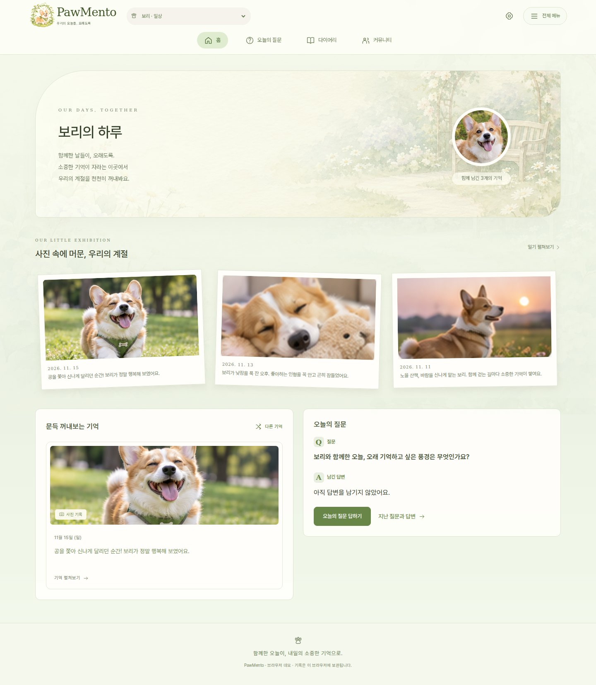
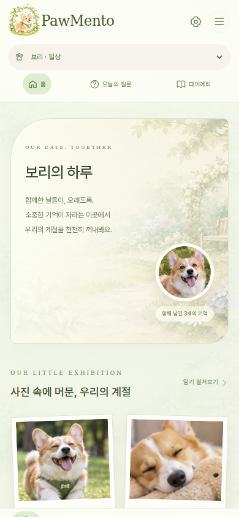
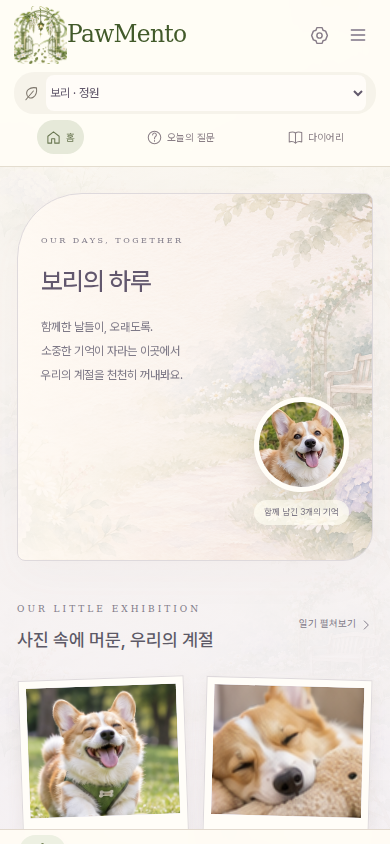
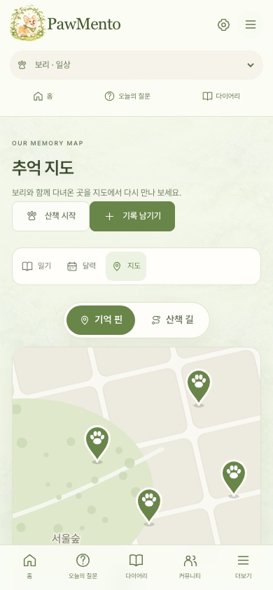
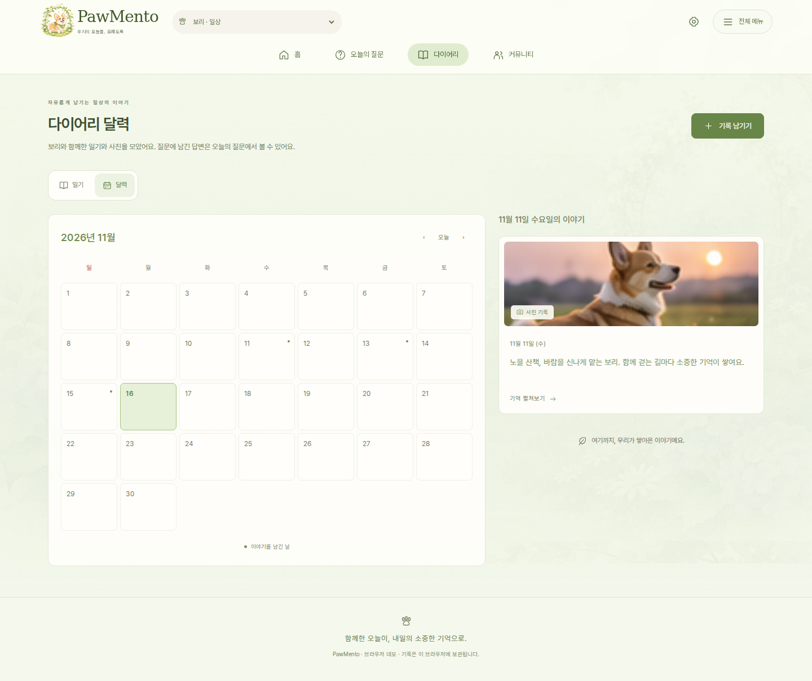
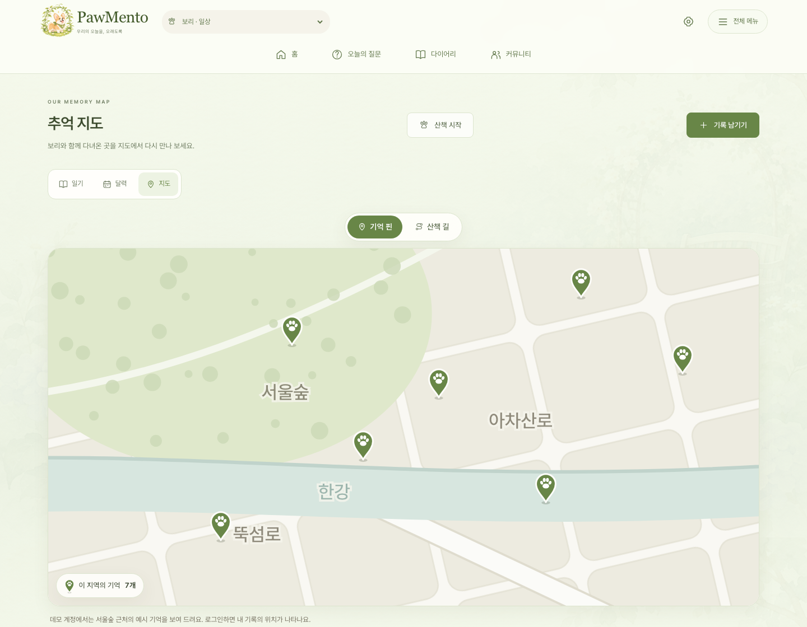
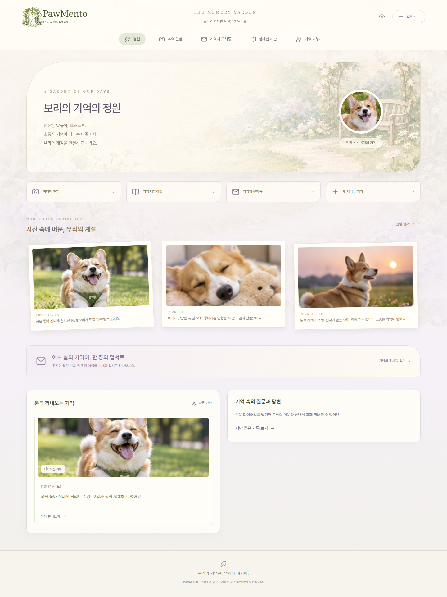
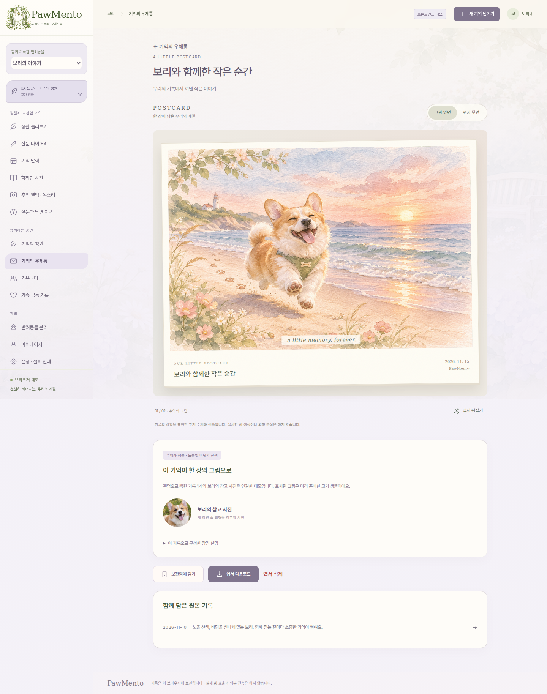
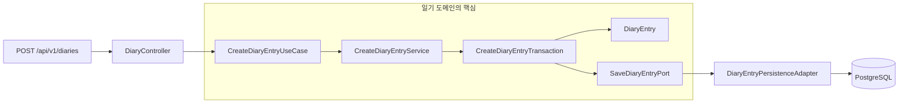
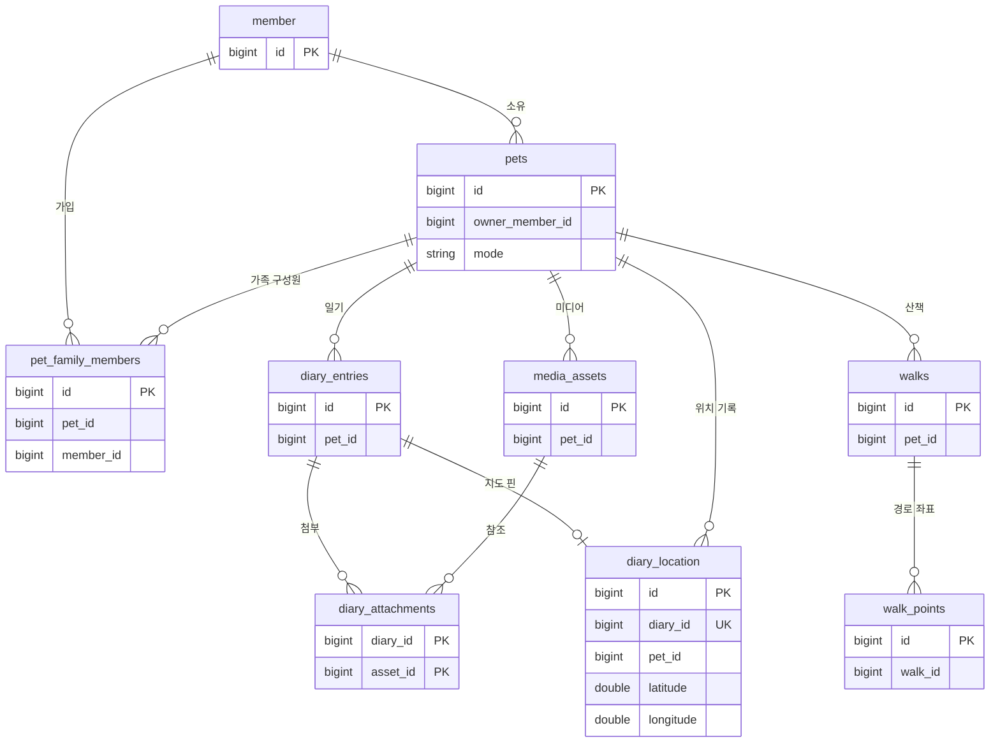

<p align="center">
  
</p>

<h1 align="center">PawMento</h1>

<p align="center"><strong>함께하는 오늘부터, 오래도록 간직할 기억까지.</strong></p>

<p align="center">
  <a href="https://pawmento.newlecture.com">개발 서버</a> ·
  <a href="#화면으로-보는-pawmento">화면 둘러보기</a> ·
  <a href="#실행과-확인">로컬에서 실행</a>
</p>

산책하다 오래 멈춰 선 곳, 낮잠에서 깬 얼굴, 이름을 부를 때 들리던 발소리. PawMento는 반려동물과 함께한 평범한 하루를 사진과 목소리, 짧은 글로 남기는 서비스입니다. 스마트폰에서 바로 열 수 있고, 지원하는 브라우저에서는 홈 화면에 추가해 PWA로 사용할 수 있습니다.

## 목차

1. [PawMento를 만든 이유](#pawmento를-만든-이유)
2. [화면으로 보는 PawMento](#화면으로-보는-pawmento)
3. [기술 스택과 코드 구조](#기술-스택과-코드-구조)
4. [실행과 확인](#실행과-확인)
5. [배포와 협업](#배포와-협업)
6. [만든 사람들](#만든-사람들)

## PawMento를 만든 이유

<p align="center">
  
</p>

사진첩을 넘기다 보면 반려동물의 모습은 선명한데, 그날 어디에 갔는지, 왜 그렇게 웃었는지, 이름을 부르자 어떤 소리가 들렸는지는 점점 흐려집니다. 일기로 남기고 싶어도 빈 화면 앞에서 무슨 말부터 써야 할지 막막할 때가 있습니다. 팀은 이런 순간을 오래 간직하려면 **기록을 시작하는 일**과 **나중에 다시 찾아보는 일**이 모두 쉬워야 한다고 생각했습니다.

- **한 문장으로 시작하기** · 오늘의 질문에 짧게 답하거나 자유롭게 일기를 쓰고, 그날의 사진과 음성을 함께 남길 수 있게 했습니다.
- **장소에서 기억 찾기** · 달력에서 날짜를 고르거나, 추억 지도에서 단골 산책길과 사진을 찍은 장소를 따라 지난 기록을 찾아볼 수 있게 했습니다.
- **내 속도로 다시 보기** · 이별을 겪은 뒤에는 보호자가 준비됐을 때 기억의 정원을 직접 열 수 있도록 했습니다. 음성도 듣고 싶을 때 눌러 재생합니다.

팀은 이 출발점을 바탕으로 보호자의 기록 습관과 질문형 기록에 대한 반응을 알아보기 위한 첫 사용자 설문을 설계했습니다. [사용자 설문 설계](docs/research/user-survey.md), [질문 설계](docs/question/README.md), [지도 설계](docs/map/README.md)

## 화면으로 보는 PawMento

### 웹 · 데스크톱

<p align="center">
  
</p>

### 앱 · 모바일 PWA

**함께하는 오늘** · **기억의 정원** · **추억 지도**

<p align="center">
  <a href="docs/Frontend/screenshots/daily-mobile.png"></a>
  <a href="docs/Frontend/screenshots/garden-mobile.png"></a>
  <a href="docs/Frontend/screenshots/map-mobile.png"></a>
</p>

### 웹에서 둘러보는 주요 기능

#### 오늘의 질문에 답하고, 달력에서 다시 만나기

오늘의 질문 한 문장에 답하거나, 마음에 남은 일을 자유롭게 적습니다. 달력에서 날짜를 골라 그날의 일기를 다시 읽을 수 있습니다.

<p align="center">
  
  
</p>

#### 추억 지도와 산책 기록

<p align="center">
  
</p>

*데스크톱의 추억 지도에 데모용 기억 핀을 표시한 화면입니다.*

- **추억 지도** · 일기에 장소를 직접 표시하거나, 위치 사용에 동의한 사진의 GPS 정보를 이용해 지도에 핀을 남깁니다.
- **산책 기록** · 산책을 시작하고 끝내면 그사이 수집한 GPS 좌표를 경로로 저장합니다. 저장한 경로는 날짜별로 다시 볼 수 있습니다.

지도 화면은 `/pets/[petId]/map`에 있습니다. 로컬에서 네이버 지도 키를 설정하면 실제 지도를 볼 수 있고, 키가 없으면 예시 지도가 표시됩니다. [지도 기능과 로컬 설정](docs/map/README.md)

#### 기억의 정원에서, 한 장의 엽서로

보호자는 반려동물마다 **함께하는 오늘(ACTIVE)** 과 **기억의 정원(GARDEN)** 모드를 직접 선택합니다. 정원에서는 남겨 둔 기억을 다시 보고, 일기 한 편을 골라 기억 엽서를 만들 수 있습니다.

<p align="center">
  
  
</p>

### 현재 구현 범위

- 회원가입·로그인, 여러 반려동물의 프로필 관리, 지도·산책 화면은 백엔드 API에 연결되어 있습니다.
- 백엔드는 일기·질문 답변의 사진과 음성 첨부, 날짜별 일기 조회, 커뮤니티 게시글 관리, 가족 초대 코드 발급·가입 API를 제공합니다.
- 일기·질문·엽서 등 일부 화면은 브라우저 목업으로 동작합니다. 기억 엽서 백엔드는 로컬 기본 설정에서 외부 AI 키 없이 생성 흐름을 확인할 수 있습니다. [앱 데모 문서](docs/app-demo/README.md), [엽서 생성 설계](docs/postcard/generate.md)

## 기술 스택과 코드 구조

**프론트엔드**


**백엔드**


**데이터와 파일**


**실행과 배포**


미디어 파일은 파일시스템에 저장합니다.

### 코드 구조

```text
pawmento/
├── frontend/
│   ├── app/          페이지, 레이아웃, 의존성 조립
│   ├── features/     반려동물·일기·질문·지도 등 기능별 UI와 API 연결
│   ├── components/   공용 UI
│   └── mocks/        데모 데이터와 브라우저 목업
├── backend/
│   └── src/main/java/com/pawmento/
│       ├── global/   공통 보안, 예외 처리, 웹 설정
│       ├── diary/    일기 도메인
│       └── …         member, pet, question, media, map 등
├── nginx/            웹·API 요청 분기
├── docs/             도메인별 요구사항과 설계 결정
└── compose.yaml      전체 서비스 구성
```

[문서 안내](docs/README.md), [프론트엔드 구조](docs/frontend-structure/README.md)

### 헥사고날 아키텍처 · 일기 작성 예시



화살표는 실행 흐름입니다. 컨트롤러는 입력 포트를 호출하고, 생성 트랜잭션은 도메인 객체를 만든 뒤 출력 포트로 저장을 요청합니다. 코드 의존성은 저장 어댑터에서 출력 포트 쪽을 향합니다. 포트는 `application/port/`, 업무 규칙은 `domain/`, HTTP와 저장소 구현은 `adapter/`에 둡니다. [백엔드 구조](docs/backend-architecture.md)

### 핵심 ERD · 반려동물과 기록

반려동물을 중심으로 일기, 첨부, 지도 핀, 산책, 가족 관계를 보여 줍니다. 선은 코드에서 사용하는 ID 관계와 개수를 나타냅니다.



[반려동물](docs/pet/README.md), [다이어리](docs/diary/README.md), [미디어](docs/media/README.md), [가족](docs/family/README.md), [지도](docs/map/README.md)

## 실행과 확인

### Docker로 전체 실행

Docker를 켜고 저장소 루트에서 실행합니다.

```sh
docker compose up --build
```

브라우저에서 [localhost:8000](http://localhost:8000)을 엽니다. nginx가 웹 요청은 프론트엔드로, `/api/` 요청은 백엔드로 전달합니다. 종료할 때는 같은 위치에서 `docker compose down`을 실행합니다.

### 개발 서버 따로 실행

Java 21, Node.js 24, Docker가 필요합니다. 백엔드와 프론트엔드는 별도 터미널에서 실행합니다.

백엔드는 `backend/`에서 실행합니다. Spring Boot가 이 폴더의 `compose.yaml`로 PostgreSQL을 띄웁니다. IDE에서도 작업 디렉터리를 `backend/`로 지정합니다.

```sh
cd backend
./gradlew bootRun
```

프론트엔드는 저장소 루트에서 다음 명령으로 실행합니다.

```sh
cd frontend
npm ci
npm run dev
```

웹은 [localhost:3000](http://localhost:3000), 백엔드는 [localhost:8080](http://localhost:8080)에서 동작합니다. 프론트엔드 개발 서버가 `/api/` 요청을 백엔드로 전달합니다. 백엔드를 종료한 뒤 개발 DB도 끄려면 `backend/`에서 `docker compose down`을 실행합니다.

사진·음성 처리를 직접 확인하려면 `ffmpeg`, `ffprobe`, `prlimit`가 필요합니다. 전체 실행용 Docker 이미지에는 이 도구가 포함되어 있습니다. [미디어 실행 환경](docs/media/runtime.md)

### 검사 명령

| 실행 위치 | 명령 | 확인 범위 |
| --- | --- | --- |
| `backend/` | `./gradlew test` | 백엔드 테스트. Testcontainers가 테스트용 PostgreSQL을 띄웁니다. |
| `frontend/` | `npm run lint` | ESLint 검사 |
| `frontend/` | `npm test` | 프론트엔드 테스트 |
| `frontend/` | `npm run build` | 프론트엔드 빌드 |

변경 범위에 맞는 로컬 검사와 백엔드 미디어 테스트의 추가 도구는 저장소 문서를 참고합니다. [검증 기준](docs/testing.md), [미디어 실행 환경](docs/media/runtime.md)

## 배포와 협업

`develop`에 머지하면 GitHub Actions가 검사와 이미지 빌드를 거쳐 이미지를 GHCR에 올리고 공용 개발 서버에 배포합니다. 운영 서버 배포는 계획 단계입니다. [개발 서버](https://pawmento.newlecture.com), [배포와 DB 구성](docs/deploy.md)

- **Compose 설정** · 루트의 `compose.yaml`은 공통 서비스를 정의합니다. 로컬에서는 `compose.override.yaml`이 자동으로 적용되고, 서버에서는 `compose.prod.yaml`을 명시해 GHCR 이미지를 실행합니다.
- **기능 변경** · 이슈를 만들고 해당 도메인의 계획 문서에서 요구사항과 시나리오를 검토합니다. [협업 규칙](CONTRIBUTING.md)
- **서비스 원칙** · 기억을 다시 볼 시점과 방식은 보호자가 고릅니다. 음성은 사용자가 재생하고, AI 생성 이미지는 원본 기록과 구분합니다.

<h2 align="center">만든 사람들</h2>

<div align="center">
<table align="center">
  <tr>
    <td valign="top">
      <table align="center">
        <tr>
          <td align="center" valign="top" width="144">
          <a href="https://github.com/LuvZian"></a><br>
          <a href="https://github.com/LuvZian"><strong>김선아</strong></a><br>
          <sub>@LuvZian · 👑 팀 리더</sub><br><br>
          <strong>일기와 질문</strong><br>
          <sub>다이어리·질문 조회<br>가족 기록 권한 검증</sub><br><br>
          <a href="https://github.com/likelion-backendschool-9th/pawmento/pulls?q=is%3Apr+author%3ALuvZian">PR 보기 ↗</a>
          </td>
        </tr>
      </table>
    </td>
    <td width="8">&nbsp;</td>
    <td valign="top">
      <table align="center">
        <tr>
          <td align="center" valign="top" width="144">
          <a href="https://github.com/jangabc3"></a><br>
          <a href="https://github.com/jangabc3"><strong>장준영</strong></a><br>
          <sub>@jangabc3</sub><br><br>
          <strong>정보 지도</strong><br>
          <sub>장소 조회·화면 연동<br>공공데이터 수집</sub><br><br>
          <a href="https://github.com/likelion-backendschool-9th/pawmento/pulls?q=is%3Apr+author%3Ajangabc3">PR 보기 ↗</a>
          </td>
        </tr>
      </table>
    </td>
    <td width="8">&nbsp;</td>
    <td valign="top">
      <table align="center">
        <tr>
          <td align="center" valign="top" width="144">
          <a href="https://github.com/lakesole"></a><br>
          <a href="https://github.com/lakesole"><strong>곽다윗</strong></a><br>
          <sub>@lakesole</sub><br><br>
          <strong>회원과 가족</strong><br>
          <sub>계정 태그·소셜 계정<br>가족 초대 코드</sub><br><br>
          <a href="https://github.com/likelion-backendschool-9th/pawmento/pulls?q=is%3Apr+author%3Alakesole">PR 보기 ↗</a>
          </td>
        </tr>
      </table>
    </td>
    <td width="8">&nbsp;</td>
    <td valign="top">
      <table align="center">
        <tr>
          <td align="center" valign="top" width="144">
          <a href="https://github.com/D-Gyun103"></a><br>
          <a href="https://github.com/D-Gyun103"><strong>김도균</strong></a><br>
          <sub>@D-Gyun103</sub><br><br>
          <strong>반려동물 관리</strong><br>
          <sub>등록·관리 화면 API<br>소유주 이전</sub><br><br>
          <a href="https://github.com/likelion-backendschool-9th/pawmento/pulls?q=is%3Apr+author%3AD-Gyun103">PR 보기 ↗</a>
          </td>
        </tr>
      </table>
    </td>
    <td width="8">&nbsp;</td>
    <td valign="top">
      <table align="center">
        <tr>
          <td align="center" valign="top" width="144">
          <a href="https://github.com/isle-blu"></a><br>
          <a href="https://github.com/isle-blu"><strong>양덕관</strong></a><br>
          <sub>@isle-blu</sub><br><br>
          <strong>엽서와 프론트엔드</strong><br>
          <sub>AI 이미지 생성<br>기능별 폴더와 목업</sub><br><br>
          <a href="https://github.com/likelion-backendschool-9th/pawmento/pulls?q=is%3Apr+author%3Aisle-blu">PR 보기 ↗</a>
          </td>
        </tr>
      </table>
    </td>
  </tr>
</table>
</div>
