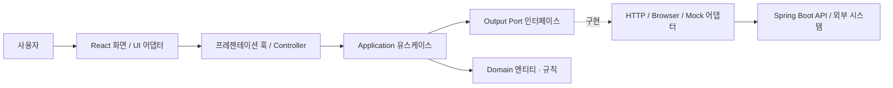

# PawMento — 헥사고날 아키텍처 기반 프론트엔드 개발 청사진

> **문서 버전:** 2.0 (2026-11-15)<br>
> **근거:** `PawMento_기능명세_원본.md` · 82개 기능, P1/P2/P3 단계<br>
> **전제:** Next.js App Router + React + TypeScript · **PC 웹 먼저**, 반응형 모바일 웹 → PWA · 프론트엔드 1인 개발<br>
> **아키텍처:** 프론트엔드의 **Ports & Adapters(헥사고날)**. 백엔드 헥사고날 구조와는 **별개로 적용**한다.

## 0. 설계 결론

**핵심 규칙:** React 화면은 API를 직접 호출하지 않고 **유스케이스를 실행**한다. 유스케이스는 HTTP나 브라우저 저장소를 몰라야 하며 **포트(interface)**에만 의존한다. HTTP 구현·파일 업로드·브라우저 API는 바깥쪽 **어댑터**가 담당한다. 도메인은 React·TanStack Query·Axios·라우터를 import하지 않는다.



- **Domain**: `Pet`, `Record`, `Question`, `PetMode` 등 순수 타입·불변식·검증 로직. 브라우저와 프레임워크 비의존.
- **Application**: 가입, 반려동물 선택, 오늘 질문 조회, 일기 저장, 기록 조회, 모드 전환 등 유스케이스. 포트 의존.
- **Ports**: 앱이 외부에 요구하는 계약(`PetRepository`, `RecordRepository`, `MediaStoragePort`, `AuthSessionPort` 등). TypeScript 인터페이스.
- **Adapters (outbound)**: HTTP API 클라이언트, 업로드 어댑터, 브라우저 세션 처리, 테스트용 인메모리 리포지토리.
- **Adapters (inbound)**: React 화면, UI hook, router, 이벤트 핸들러. **UI는 코어의 소비자**이지 도메인의 일부가 아님.
- **Composition root**: 앱 시작점에서 구현체를 주입. `new HttpPetRepository(apiClient)` 같은 구체 기술은 이곳에서만 조립.

**과설계 금지:** 1인 개발이므로 타입만 반복하는 의미 없는 파일을 만들지 않는다. 반드시 교체 가능해야 하는 경계(서버 요청, 브라우저 저장소, 파일 업로드 등)에 포트를 두고, 단순 스타일/표시 로직에는 유스케이스를 억지로 만들지 않는다.

## 1. 의존성 규칙과 경계

| 계층 | 사용할 수 있는 것 | 사용하면 안 되는 것 | 테스트 방식 |
|---|---|---|---|
| `domain` | 자체 엔티티, 순수 유틸 | React, fetch, localStorage, 라우터, CSS | 순수 단위 테스트 |
| `application` | domain, **포트 타입** | Axios, React, DOM, API 응답 DTO | 가짜 포트 주입 단위 테스트 |
| `adapters/outbound` | 포트·domain, API 클라이언트 | JSX·페이지 컴포넌트 | Mock Service Worker/통합 테스트 |
| `adapters/inbound` | 유스케이스, view model, UI | HTTP 엔드포인트 직접 호출 | 컴포넌트 테스트 |
| `app/composition` | 모든 구현체를 조립 | 비즈니스 규칙 | 부팅 스모크 테스트 |
| `shared/ui` | 디자인 토큰, 범용 컴포넌트 | 도메인 API 접근 | Storybook/컴포넌트 테스트 |

- 모든 경계는 **외부 → 내부** 방향으로 의존한다. `application` 안의 포트에 인프라 구현체가 의존하는 **의존성 역전**을 지킨다.
- 서버 JSON 응답 형태(`PetResponseDto`)와 도메인 모델(`Pet`)을 구분한다. **DTO → domain 매핑은 outbound 어댑터에서** 처리한다.
- 도메인 규칙은 **백엔드에서 최종 검증**해야 한다. FE 도메인은 UX용 사전 검증이지 권한·무결성의 보안 경계가 아니다.
- 저장소 응답·에러를 유스케이스가 해석하고 화면에서는 `loading/empty/error/success` 형태의 표시 상태를 만든다.
- **TanStack Query는 UI 경계의 캐시 및 비동기 상태 관리 도구**이지 application/domain의 의존성이 아니다. hooks의 `queryFn`에서 유스케이스를 호출한다.

## 2. 프로젝트 폴더 트리 (권장)

기존 선호를 반영해 `pages/`, `features/`, `services/`, 전체 CSS를 모아둔 `styles/` 폴더는 만들지 않는다. 라우트 정의는 `src/app/(auth)`·`src/app/(app)`의 명시적인 `page.tsx` 파일에서 관리하고 공통 인증·Shell은 `(app)/layout.tsx`에서 공유한다. 각 페이지는 필요한 inbound 화면만 import하며, 브라우저 저장소를 사용하는 화면의 Client Component 경계를 유지한다. (고침 #12: Next.js 유지 결정과 파일 기반 라우트 리뷰 반영) 화면·스타일은 **각 기능의 inbound adapter 옆에 코로케이션**한다.

```text
frontend/
├─ public/                         # 로고·수채화·사진·PWA 에셋
├─ src/
│  ├─ app/
│  │  ├─ layout.tsx                # 공통 provider·글로벌 CSS
│  │  ├─ page.tsx                  # 공개 진입 화면
│  │  ├─ (auth)/                   # sign-in·sign-up·reset-password·offline
│  │  ├─ (app)/
│  │  │  ├─ layout.tsx             # 인증·공통 Shell·Suspense
│  │  │  ├─ loading.tsx / error.tsx / not-found.tsx
│  │  │  ├─ home/page.tsx
│  │  │  ├─ pets/[petId]/          # 프로필·기록·질문·정원·가족
│  │  │  ├─ community/[postId]/    # 목록·작성·상세·수정
│  │  │  ├─ me/                   # 내 정보·활동
│  │  │  └─ admin/                # 운영 화면별 페이지
│  │  ├─ AppProvider.tsx           # 브라우저 데모 세션·상태
│  │  └─ composition.ts           # 포트 ↔ 어댑터 조립
│  ├─ auth/                       # domain/application/adapters
│  ├─ workspace/                  # 반려동물·기록·질문: 같은 경계
│  ├─ life/                       # 커뮤니티·가족·엽서·운영: 같은 경계
│  └─ shared/                     # 날짜·이탈 확인·범용 UI와 토큰
├─ next.config.ts
└─ package.json
```

**선택적 축소:** 도메인이 매우 작으면 `domain/index.ts`, `application/ports.ts`, `application/useCases.ts`로 시작하고 복잡해질 때만 분할한다. UI CSS는 반드시 컴포넌트 옆에 둔다. 파일이 3개 이상으로 늘어나는 경우에만 하위 폴더를 추가해도 된다.

## 3. 실제 구현 계약 (TypeScript 예시)

### 3.1 도메인 모델 — HTTP 응답과 독립

```ts
// pets/domain/Pet.ts
export type PetMode = 'ACTIVE' | 'GARDEN';
export type Pet = Readonly<{
  id: string;
  name: string;
  species: 'DOG' | 'CAT' | 'OTHER';
  breed?: string;
  photoUrl?: string;
  mode: PetMode; // MODE 기능은 P2, 모델 확장 슬롯은 미리 준비 가능
}>;

// records/domain/Record.ts
export type RecordType = 'DIARY' | 'PHOTO' | 'VIDEO' | 'VOICE' | 'TEXT';
export type RecordItem = Readonly<{
  id: string; petId: string; type: RecordType;
  recordedDate: string; body?: string;
  questionId?: string;
  mediaIds: readonly string[];
}>;
```

`PetMode`, `RecordType`, 종 코드 등은 **API 협의용 제안**이다. 원본 기능명세는 기능 요구사항이지 서버 필드명 확정 문서가 아니다.

### 3.2 Output port — HTTP를 모르는 계약

```ts
// pets/application/ports/PetRepository.ts
import type { Pet } from '../../domain/Pet';
export interface PetRepository {
  listMine(): Promise<readonly Pet[]>;
  getById(petId: string): Promise<Pet>;
  create(input: { name: string; species: Pet['species'] }): Promise<Pet>;
}
```

### 3.3 Application use case — 포트 주입, React 의존 없음

```ts
// pets/application/useCases/ListPets.ts
import type { PetRepository } from '../ports/PetRepository';
export const createListPets = (pets: PetRepository) =>
  async () => pets.listMine();

// diaries/application/useCases/GetTodayQuestion.ts
export const createGetTodayQuestion = (questions: QuestionRepository) =>
  async (petId: string, localDate: string) => {
    if (!petId || !/^\d{4}-\d{2}-\d{2}$/.test(localDate))
      throw new Error('Invalid question request');
    return questions.findForDate(petId, localDate);
  };
```

위 `QuestionRepository`는 별도 포트 인터페이스로 정의하며, 예시는 유스케이스 모양을 보여주기 위해 import를 생략했다.

### 3.4 Outbound adapter — 외부 DTO를 domain으로 매핑

```ts
// pets/adapters/outbound/HttpPetRepository.ts
import type { PetRepository } from '../../application/ports/PetRepository';
import type { Pet } from '../../domain/Pet';
import type { ApiClient } from '../../../shared/http/apiClient';

type PetDto = { id: string; name: string; species: string; imageUrl?: string };
export class HttpPetRepository implements PetRepository {
  constructor(private readonly http: ApiClient) {}
  async listMine(): Promise<readonly Pet[]> {
    const data = await this.http.get<PetDto[]>('/pets'); // 엔드포인트는 예시
    return data.map((p): Pet => ({
      id: p.id, name: p.name,
      species: p.species === 'DOG' || p.species === 'CAT' ? p.species : 'OTHER',
      photoUrl: p.imageUrl, mode: 'ACTIVE', // MODE API 확정 후 서버 값으로 교체
    }));
  }
  async getById(id: string) { const list = await this.listMine(); const pet = list.find(p => p.id === id); if (!pet) throw Error('Not found'); return pet; }
  async create(input: {name:string; species:Pet['species']}) {
    const data = await this.http.post<PetDto>('/pets', input);
    return { id:data.id, name:data.name, species:input.species, photoUrl:data.imageUrl, mode:'ACTIVE' as const };
  }
}
```

위 `getById`의 목록 재조회는 **설명용 임시 구현**일 뿐 실제 제품에서는 상세 조회 API를 연결한다. 임의 `mode:'ACTIVE'` 역시 P1에서의 예시이고 **P2에서는 서버 제공 모드를 반드시 반영**한다. 저장소 변경 사항을 로컬에서만 신뢰하지 않는다.

### 3.5 Composition root 및 inbound adapter

```ts
// app/composition.ts
const http = createApiClient({ baseUrl: import.meta.env.VITE_API_BASE_URL });
const petRepository = new HttpPetRepository(http);
export const dependencies = {
  pets: { list: createListPets(petRepository) },
};

// pets/adapters/inbound/useMyPets.ts (React Query 예시)
export const useMyPets = () => useQuery({
  queryKey: ['pets', 'mine'],
  queryFn: () => dependencies.pets.list(),
});
```

실제 코드에서는 각 예시의 import를 명시해야 한다. Query의 cache key는 `petId`, 날짜, 정렬 필터 등을 포함해 서로 다른 기록이 섞이지 않게 한다. 애플리케이션 계층에서 `useQuery`를 호출하지 않는다.

### 3.6 작업 중 혼동하면 안 될 것

- **포트는 API URL이 아니라 인터페이스다.** `/api/v1/pets`는 어댑터 세부 구현이다.
- **`getPet()` 같은 얇은 HTTP 래퍼만 두는 건 헥사고날의 핵심이 아니다.** 업무 목적을 표현하는 `GetPet`, `CreateDiary` 유스케이스를 두고 외부 의존을 역전시켜야 한다.
- UI validation(Zod 등)은 입력 경험을 위한 것이며, 도메인의 중요 불변식은 순수 함수로, 최종 검증은 서버에서 한다.
- 파일 `File`, `Blob`, `window`, `navigator` 등 브라우저 타입이 코어에 무분별하게 퍼지지 않게 한다. 업로드 입력을 application이 반드시 다뤄야 할 때는 바이트 스트림/메타정보 계약으로 추상화하거나 UI 어댑터에서 파일 선택 후 업로드 포트로 전달한다.
- React 컴포넌트에서 `fetch`/`axios` 금지; application에서 `localStorage`·`document`·라우터 사용 금지.

## 4. 기능별 경계 및 개발 단계

| 기능군 | 대표 유스케이스 | 출력 포트/어댑터 | 화면(inbound) | 원본 우선순위 |
|---|---|---|---|---|
| 회원·인증 | `SignUp`, `SignIn`, `RefreshSession`, `GetMe` | `AuthRepository` / HTTP·세션 어댑터 | SignIn/Up, Me | P1 일부, 나머지 P2 |
| 반려동물 | `CreatePet`, `ListPets`, `UpdatePet`, `SelectPet` | `PetRepository` / HTTP | PetForm/List/Switcher | P1 |
| 오늘의 질문 | `GetTodayQuestion`, `SaveDiary`, `EditDiary` | `QuestionRepository`, `RecordRepository` / HTTP | ActiveHome, DiaryEditor | P1, 지난 질문 P2 |
| 아카이브 | `CreateRecord`, `ListRecordsByDate`, `ListTimeline` | `RecordRepository`, `MediaStoragePort` / HTTP·업로드 | Editor/Calendar/Timeline | P1, 미디어 확장 P2 |
| 화면 모드 | `GetPetMode`, `ChangePetMode` | `PetRepository` / HTTP | ModeSettings | P2 |
| 기억의 정원 | `GetOnThisDay`, `GetRandomMemory`, `ListMedia` | `RecordRepository` / HTTP | GardenHome/Media | P2 |
| 커뮤니티 | `ListPosts`, `WritePost`, `WriteComment`, `ReportPost` | `CommunityRepository` / HTTP | Community screens | P2 |
| AI 엽서 | `RequestPostcard`, `GetGenerationStatus`, `ListPostcards` | `PostcardRepository` / HTTP | GardenMailbox | P3 |
| 가족 공유 | `InviteFamily`, `AcceptInvite`, `ChangeRole` | `FamilyRepository` / HTTP | Family settings | P3 |
| PWA | `GetInstallEligibility` 등 UI 브라우저 행동 | `InstallPromptAdapter`, service worker | InstallBanner/Offline | P1 반응형, 나머지 P2 |

> **기획 차이 주의:** 첨부 명세에 `DIARY-08`/`COM-02` 알림(P2)이 있지만 기존 기획은 **외부 알림 없는 서비스**다. 팀 결정 전 자동 푸시를 만들지 않는다. 기존 기획의 우체통은 **GARDEN 전용(P3)**이며 ACTIVE에 표시하지 않는다. AI 엽서는 실제 반려동물의 말이 아닌 **AI가 기록을 바탕으로 만든 상상 엽서**라고 표시한다.

## 5. API, 날짜, 업로드 설계 지침

1. **API 클라이언트 한 개:** base URL, 공통 헤더, 쿠키/세션 처리, 오류 정규화는 `shared/http`에서 통일. URL 및 서버 DTO는 outbound 어댑터에만 둔다.
2. **인증:** 쿠키/BFF/JWT 저장 방식은 BE와 협의한다. `localStorage` 토큰 저장을 전제로 박아두지 않는다. CSRF·CORS 및 만료 복구를 계약에 명시한다.
3. **날짜:** 날짜 기반 질문은 `YYYY-MM-DD`로 다루고 로컬 날짜와 UTC timestamp를 구분한다. 서버가 기준 시간대 확정.
4. **미디어:** `ARCH-01` 사진 P1, `ARCH-02/03` 영상·음성 P2. presigned URL 또는 multipart 계약에 따라 포트를 구현한다. 파일 제한, 진행률, 취소·재시도 처리.
5. **단일 기록:** `DIARY`와 사진/텍스트 기록은 같은 `Record` 도메인을 공유한다. 질문은 기록에 참조값으로 연결, GARDEN은 같은 조회 포트 사용.
6. **에러 타입:** `UNAUTHORIZED`, `FORBIDDEN`, `NOT_FOUND`, `VALIDATION`, `NETWORK`, `UNKNOWN` 등을 도메인 외부에서 정규화. 화면은 친절한 메시지 출력.
7. **캐싱:** Query key를 계정·반려동물·날짜·카테고리별로 구분. 생성·수정·삭제 성공 시 관련 캐시 invalidate.
8. **Mocks:** `InMemoryPetRepository`, `InMemoryRecordRepository`를 P1부터 제공하여 백엔드 개발과 무관하게 UI 검증. 운영 모드와 목업 모드는 composition root에서 선택.

## 6. 1인 프론트 개발 실행 순서

### Stage 0 — 경계와 디자인 시스템
- [ ] Next.js App Router + TypeScript, 테스트 러너, 포맷터, 페이지별 라우트·레이아웃·오류 경계 설정 (고침 #12: Next.js를 유지하고 중앙 화면 분기를 제거)
- [ ] 디자인 토큰 CSS와 범용 Button/Input/Dialog/Toast 등 구현
- [ ] 공통 `ApiClient`, 오류 매핑, composition root 설계
- [ ] Pet/Question/Record 도메인 모델과 핵심 포트·Mock 어댑터 작성
- [ ] 한 유스케이스(`ListPets`)를 끝까지 수직 슬라이스로 구현해 구조 검증

### Stage 1 — P1 인증·반려동물
- [ ] AUTH-01/02/04/05/06, COM-03
- [ ] PET-01~08 및 프로필 이미지 업로드
- [ ] Mock→HTTP 어댑터 교체, 인증 오류·상태 경계 검사

### Stage 2 — P1 질문형 일기·기록
- [ ] DIARY-01~05/07, ARCH-01/04~08
- [ ] 오늘 질문 → 사진과 답 → 기록 저장 → 달력·타임라인
- [ ] 질문형 일기와 아카이브가 같은 Record를 참조하는지 검증

### Stage 3 — P1 웹 품질
- [ ] PC 레이아웃 → 태블릿·모바일 반응형
- [ ] 권한·로딩·빈 데이터·오류·접근성·재시도 검사
- [ ] 명세 원본의 ADMIN-02 질문 풀 관리: 초기 DB seed로 대체 가능

### Stage 4 — P2
- [ ] MODE-01~04 + GARDEN-01~05; 새로운 API라도 코어 모델 재사용
- [ ] 커뮤니티 11개 기능, 영상·음성, 설치형 PWA
- [ ] 알림 P2는 기획 결정 후 구현

### Stage 5 — P3
- [ ] 엽서·가족 공유 기능별 포트/어댑터 추가
- [ ] AI 엽서 생성/상태/다운로드, GARDEN 전용 우체통
- [ ] 개인정보·모델 결과 표시·사용자 동의·비용 확인

**각 기능의 Done 기준:** Domain 규칙 테스트 → UseCase 가짜 포트 테스트 → HTTP adapter 통합 테스트 → React 상호작용 테스트 → E2E 시연 경로. 서버와 동기화가 가능한지 확인하고 종료한다.

## 7. 아키텍처 테스트 및 방지 규칙

- `domain/**`에서 `react`, `axios`, `@tanstack/react-query`, `window`, `document` import 금지.
- `application/**`에서 HTTP 구현체, DTO 타입, React hook import 금지.
- inbound 화면에서 `fetch('/...')`나 구체 `HttpXRepository` 직접 생성 금지.
- 실물 데이터가 없는 상태에서 각 유스케이스는 Mock 포트로 테스트 가능해야 함.
- API DTO가 바뀌어도 도메인/유스케이스 수정 없이 adapter/mapper만 바꾸는 것이 목표.
- API 가동 중단 시 화면이 오류를 보여주되 입력 폼을 잃지 않도록 구현.
- GARDEN 전환 전후 사용자 기록은 동일한 Record 식별자를 유지해야 함.

## 8. 적용 전 백엔드와 확인할 것

- [ ] Spring Boot 엔드포인트와 인증(쿠키 vs JWT, 리프레시, CSRF)
- [ ] Pet/Question/Record DTO 규격, 에러 응답 포맷 및 등록/삭제 응답
- [ ] 오늘 질문의 날짜 기준, 미작성 질문 허용 방식
- [ ] 멀티파일 업로드 단계, 제한 및 접근 제어
- [ ] 타임라인 페이지네이션(커서/페이지)
- [ ] ACTIVE/GARDEN 서버 저장, 전환/되돌리기, GARDEN 사용 권한
- [ ] 커뮤니티 카테고리, 정렬, 신고 정책
- [ ] AI 엽서 API 비용과 요청 상태·생성 상한(P3)

**이 문서의 폴더 구조·예시 코드·URL은 개발 제안이며 원본 기능명세의 확정사항이 아니다.** 원본 기능 ID와 우선순위는 별도 보존한다.

---

> 아래는 원본의 **화면/사용자 경험 요구사항**만 유지한 부록이다. 각 화면의 데이터 접근 구현은 반드시 상단의 hexagonal use case → port → adapter 체계를 따른다.

## 부록 A. 전체 화면 URL·요구사항 매핑 (이전 청사진에서 유지)

라우트는 **권장 URL 초안**이다. Next.js App Router를 사용하며 `petId` 식별자와 서버 로그인 계약은 API 협의로 확정한다. **모든 페이지 라우트를 `src/pages` 폴더로 몰아넣지 않고**, 화면과 스타일을 도메인별로 코로케이션한다.

| 화면 ID | 추천 URL | 목적 | 주요 기능 ID | 단계 |
|---|---|---|---|---|
| WEB-01 | `/` | 진입·서비스 안내, 로그인 상태에 따라 이동 | 공통 | P1 |
| AUTH-UI-01 | `/sign-up` | 회원가입·중복 검증 | AUTH-01 | P1 |
| AUTH-UI-02 | `/sign-in` | 로그인 | AUTH-02,05 | P1 |
| HOME-01 | `/home` | 대표 반려동물 ACTIVE 홈·오늘의 질문 | PET-08, DIARY-01, COM-03 | P1 |
| PET-UI-01 | `/pets/new` | 반려동물 생성 | PET-01,06,07 | P1 |
| PET-UI-02 | `/pets` | 반려동물 목록·선택 | PET-02,08 | P1 |
| PET-UI-03 | `/pets/:petId` | 반려동물 상세·수정·삭제 진입 | PET-03~05 | P1 |
| DIARY-UI-01 | `/pets/:petId/diary/new` | 오늘의 질문 답변+사진 | DIARY-01,02, ARCH-01 | P1 |
| DIARY-UI-02 | `/pets/:petId/diary/:recordId` | 질문형 일기 상세·수정·삭제 | DIARY-03~05,07 | P1 |
| RECORD-UI-01 | `/pets/:petId/records/new` | 자유 텍스트·사진 기록 | ARCH-01,04 | P1 |
| RECORD-UI-02 | `/pets/:petId/records/:recordId` | 기록 상세·편집·삭제 | ARCH-05,06 | P1 |
| RECORD-UI-03 | `/pets/:petId/calendar` | 월별 기록 달력 | ARCH-07 | P1 |
| RECORD-UI-04 | `/pets/:petId/timeline` | 무한 스크롤 타임라인 | ARCH-08 | P1 |
| ACCOUNT-UI-01 | `/me` | 내 정보·내 반려동물·내 활동 | AUTH-06, COM-03 | P1 |
| MODE-UI-01 | `/pets/:petId/settings/mode` | 모드 선택·확인·되돌리기 | MODE-01~04 | P2 |
| GARDEN-UI-01 | `/pets/:petId/garden` | 정원 홈, 추억 회상 | GARDEN-01~04 | P2 |
| GARDEN-UI-02 | `/pets/:petId/media` | 사진·영상·목소리 모아보기 | GARDEN-05, ARCH-02,03,09 | P2 |
| COMM-UI-01 | `/community` | 카테고리·정렬·검색 목록 | COMM-04~06 | P2 |
| COMM-UI-02 | `/community/new` | 글 작성 + 이미지 | COMM-01,09 | P2 |
| COMM-UI-03 | `/community/:postId` | 글 상세·좋아요·댓글·신고 | COMM-02,03,07,08,10 | P2 |
| COMM-UI-04 | `/me/activity` | 내가 쓴 글·댓글 | COMM-11 | P2 |
| PWA-UI-01 | `/offline` | 오프라인 안내 | PWA-05 | P2 |
| ADMIN-UI-01 | `/admin/reports` | 신고 처리(관리자 전용) | ADMIN-01,03 | P2 |
| POSTCARD-UI-01 | `/pets/:petId/garden/mailbox` | AI 엽서 목록(우체통) | AI-05~07 | P3 |
| POSTCARD-UI-02 | `/pets/:petId/garden/mailbox/:postcardId` | 엽서 상세·다운로드 | AI-05~07 | P3 |
| POSTCARD-UI-03 | `/pets/:petId/garden/postcards/new` | 원본 기록 선택·생성 상태 | AI-01~04,08 | P3 |
| FAMILY-UI-01 | `/pets/:petId/family` | 초대·구성원·권한 | FAM-01~07 | P3 |

### 접근 및 공통 레이아웃

- **공개:** `/`, `/sign-up`, `/sign-in`; 비로그인 보호 화면 접근 시 로그인으로 이동하고 복귀 URL을 유지한다.
- **인증 필요:** `/home`, `/pets/**`, `/me/**`, `/community/new` 및 게시글 작성·수정 등.
- **관리자:** `/admin/**`는 서버 권한 확인 응답이 성공한 경우에만 렌더링.
- **반려동물 없는 사용자:** 첫 로그인 후 `/pets/new`로 자연스럽게 유도. 빈 화면으로 방치하지 않는다.
- **PC 기본 레이아웃:** 상단 브랜드/탐색, 중앙 본문 최대 너비, 반려동물 전환기, 콘텐츠 우측 보조 패널(필요한 경우만).
- **모바일 레이아웃:** 헤더 축소, 하단 주요 탐색, 폼 한 열, 사진 그리드 축소. 기능 노출은 PC와 동일하게 유지.
- **GARDEN 진입:** P2 이후 프로필의 `mode`가 `GARDEN`일 때 전용 메인 표시. ACTIVE에는 **우체통 링크를 노출하지 않음**(제품 결정 확인 필요).

---

## 부록 B. 화면별 상호작용·상태 요구사항

### B.1 P1: 가입 / 로그인 / 마이페이지

**컴포넌트** `AuthForm`, `EmailField`, `PasswordField`, `FormError`, `AuthGuard`, `AccountProfileForm`, `ConfirmDialog`.

- 이메일 입력·중복 확인, 비밀번호 규칙과 확인, 닉네임, 제출 중 로딩·중복 제출 방지.
- 서버 오류(중복 이메일, 인증 실패, 401/403, 세션 만료), 입력 오류를 서로 구분해 보여준다.
- 재발급 방식은 서버 계약에 따름. **JWT를 `localStorage`에 넣는 것을 기본 결정으로 삼지 않는다**(쿠키 기반/BFF 여부 백엔드와 합의).
- 소셜 로그인/비밀번호 재설정/회원 탈퇴는 P2로 미뤄진다.

**완료 기준:** 가입→로그인→보호 페이지 접근→로그아웃→접근 차단/만료 동작까지 검증.

### B.2 P1: 반려동물 등록 / 선택 / 상세

**컴포넌트** `PetForm`, `PetAvatar`, `PetSwitcher`, `SpeciesSelect`, `BreedCombobox`, `PetSummary`, `DeletePetDialog`.

- 이름·종 필수 여부, 생일/품종/성별은 서버 제약과 맞춘다. 품종 검색 + 직접 입력 지원.
- 이미지 업로드(미리보기/취소/교체), 등록 성공 후 대표 선택 또는 목록 이동.
- 복수 반려동물 전환 시 질문과 기록 **캐시 키에 `petId` 포함**.
- 삭제 시 연관 기록 처리 정책 미확정: 구체적인 '삭제됨' 문구를 정책 확정 전 넣지 않는다.

**완료 기준:** 2마리 등록 후 전환해도 프로필·질문·기록이 섞이지 않음.

### B.3 P1: ACTIVE 홈 / 질문형 일기

**컴포넌트** `TodayQuestionCard`, `QuestionDiaryForm`, `ImageUploader`, `DraftLeaveDialog`, `RecentRecordList`, `EmptyJournalState`.

1. `/home`에서 대표 반려동물 조회 → 오늘 질문 조회 → 당일 작성 여부 확인.
2. **미작성:** 질문 카드, “사진과 답변 남기기” CTA. **작성 완료:** 기록 미리보기 및 수정/상세 CTA.
3. 이미지 업로드 후 답변 작성, 저장 성공 시 상세로 이동/홈 카드 갱신.
4. 실패 시 입력 내용은 유지하고 다시 시도하도록 한다. 작성 중 이탈 시 변경 사항 안내.
5. 날짜는 서버/사용자 시간대 규칙을 협의하고, '오늘' 판정은 일관되게 사용한다.
6. P2의 지난 질문 목록·리마인드 알림은 P1 홈 UI에 넣지 않는다.

**완료 기준:** 질문 확인→사진/답변→저장→상세→수정·삭제→홈 반영.

### B.4 P1: 자유 기록 / 달력 / 타임라인

**컴포넌트** `RecordEditor`, `RecordCard`, `RecordDetail`, `RecordCalendar`, `RecordTimeline`, `MediaViewer`.

- 일기는 `type=DIARY`, 일반 사진·텍스트 기록은 서버 계약에 따른 공통 타입으로 렌더링.
- 기록 작성일(`createdAt`)과 실제 기억 날짜(`recordedDate`)를 구분하여 화면에 표기.
- 달력은 기록이 있는 날짜에 점/썸네일을 표시, 클릭하면 해당 날짜 목록을 표시.
- 타임라인은 커서 방식 또는 페이지 방식 중 API 계약에 따른 무한 스크롤 구현. 하단 로딩·마지막 페이지 표시, 중복 fetch 방지.
- 사진 클릭 시 모달 뷰어. 비로그인/권한 없음 시 파일 URL 노출 방지.
- P2 영상·음성은 공통 `MediaRenderer` 확장으로 붙이도록 구조를 열어둔다.

**완료 기준:** 날짜 변경, 과거 기록 조회, 리스트 무한 스크롤, 수정·삭제 후 동기화.

### B.5 P2: 모드 전환 / 기억의 정원

**컴포넌트** `ModeSwitchPanel`, `ModeChangeConfirm`, `GardenHero`, `MemoryCard`, `OnThisDay`, `RandomMemory`, `MediaGallery`.

- 프로필 설정에서만 사용자가 **명시적으로** ACTIVE ↔ GARDEN 전환.
- 전환 전 기록 유지와 모드 차이를 설명하고 최종 확인. 되돌릴 수 있음을 표시.
- 전환 직후 새 모드 홈 이동; **기존 기록은 보존**, GARDEN에서도 기록 추가 가능.
- `N년 전 오늘`은 해당 데이터가 없을 때 억지로 빈 카드 노출하지 않고 다른 정원 안내 배치.
- 음성/영상 파일이 없을 때 플레이어 빈 상태 처리. **자동 재생 금지**(UX 권고).
- `MODE-01~04`는 원본상 **P2**이므로 P1에서는 ACTIVE 경험을 먼저 완성한다.

### B.6 P2: 커뮤니티

**컴포넌트** `CategoryTabs`, `PostList`, `PostCard`, `PostEditor`, `PostDetail`, `CommentList`, `CommentEditor`, `ReportDialog`.

- 반려생활/건강·돌봄/장례·추모 등 카테고리, 정렬(최신/인기), 검색어 URL 동기화.
- 게시글·댓글 작성자만 수정·삭제 버튼 표시. 서버 최종 권한 확인 필수.
- 좋아요는 요청 실패 시 되돌리는 낙관적 업데이트 여부를 정하고 일관되게 구현.
- 신고 완료 시 같은 게시글을 반복 신고할 수 있는지 서버 정책과 일치시킨다.
- 장례·추모 경험담에는 운영자가 공식 전문 정보를 보증한다는 인상을 주지 않도록 안내.

### B.7 P3: AI 기억 엽서 / 기억의 우체통

**컴포넌트** `MailboxObject`, `PostcardList`, `PostcardViewer`, `PostcardComposer`, `GenerationProgress`, `SourceRecordLink`, `AIContentLabel`.

- **P3** 기능. 기록 및 사진 선택 → AI 요청 → 대기/완료/실패 상태 → 보관함 저장 → 상세/다운로드.
- 선호 UX 제안: **우체통은 GARDEN 메인에만 배치, ACTIVE에는 미노출**. 우체통을 누르면 목록에 들어가고 엽서를 사용자가 직접 펼친다.
- 별도 선택 동의 없이는 반려동물 1인칭 상상 편지를 기본 생성하지 않는다. **“AI가 기록을 바탕으로 상상한 내용”** 명시.
- 푸시 알림, 강한 카운트 배지, 자동 음성 재생 없음(선호 UX — 알림 정책은 팀 결정).
- `generationStatus`: `PENDING | PROCESSING | COMPLETED | FAILED` 등은 **API 협의용 예시**.
- 원본 기록 링크/이미지 대비 생성 이미지 구분, AI 호출 비용을 위한 생성 한도 UI.

### B.8 P3: 가족 공동 기록

- 가족 초대/권한은 원본 `FAM-01~07` 그대로. UI는 소유자/편집자/열람자에 따른 버튼 표시를 지원.
- 초대 만료·권한 거절·공유 취소·기록 작성자 표시를 처리. 서버 권한 체크가 진실의 원천.
- P1에서도 `Record`에 `author`, 소유자와 참여자 관계가 확장될 수 있는 형태로 **API 모델을 협의**한다.

### B.9 PWA / 운영 관리자

- P1 `PWA-01` 데스크톱·모바일 반응형. P2에서 Manifest/서비스워커/설치 안내/오프라인 안내.
- P1 `COM-01` 파일 저장소 연동은 **백엔드 저장 책임**이며 FE는 파일 선택·업로드·진행·오류·미리보기를 담당.
- P1 `COM-03` 마이페이지, `ADMIN-02` 질문 데이터 제공 방식 결정.
- P2 관리자 신고 처리와 P3 회원/공지 관리 화면은 단계적으로.

---
